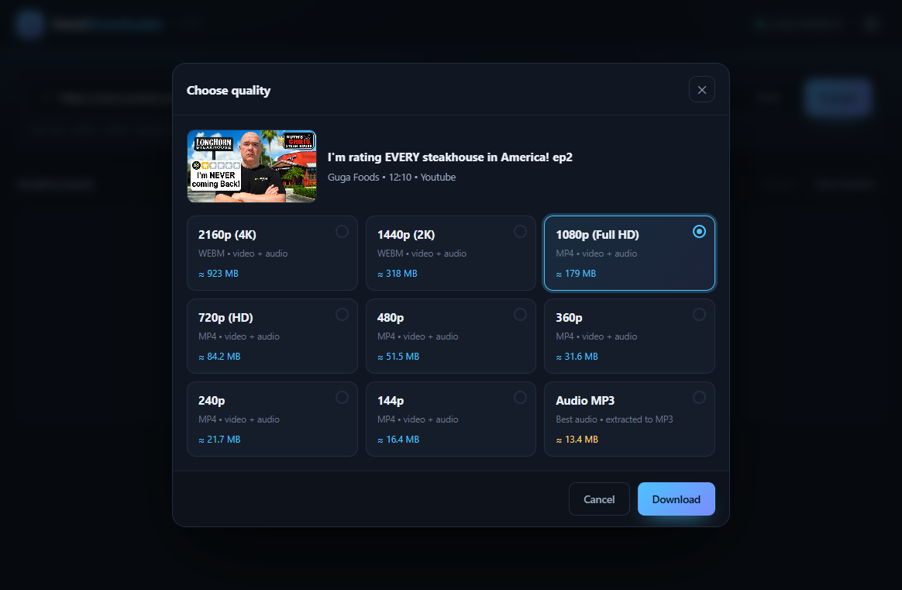
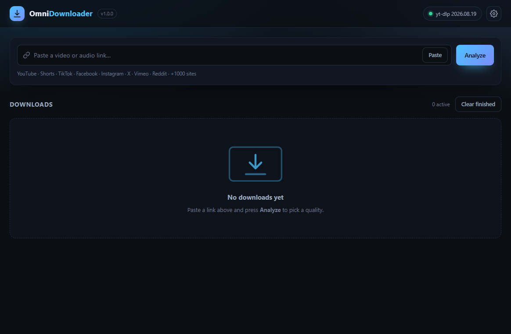
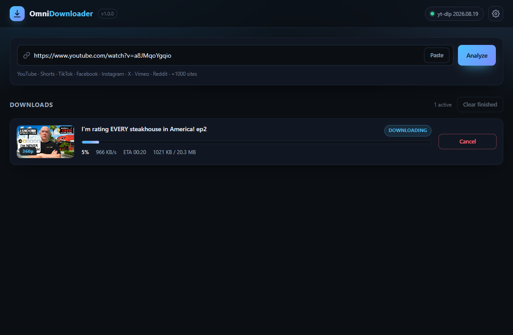
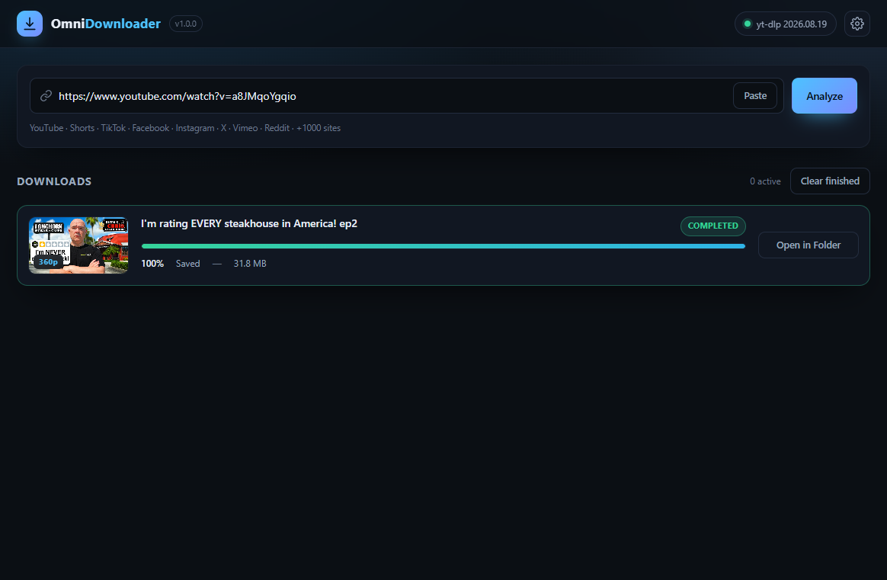
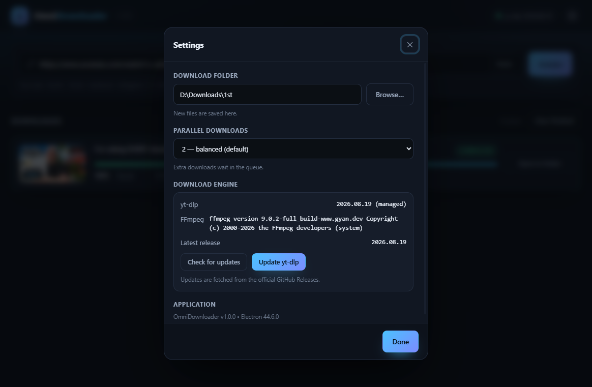
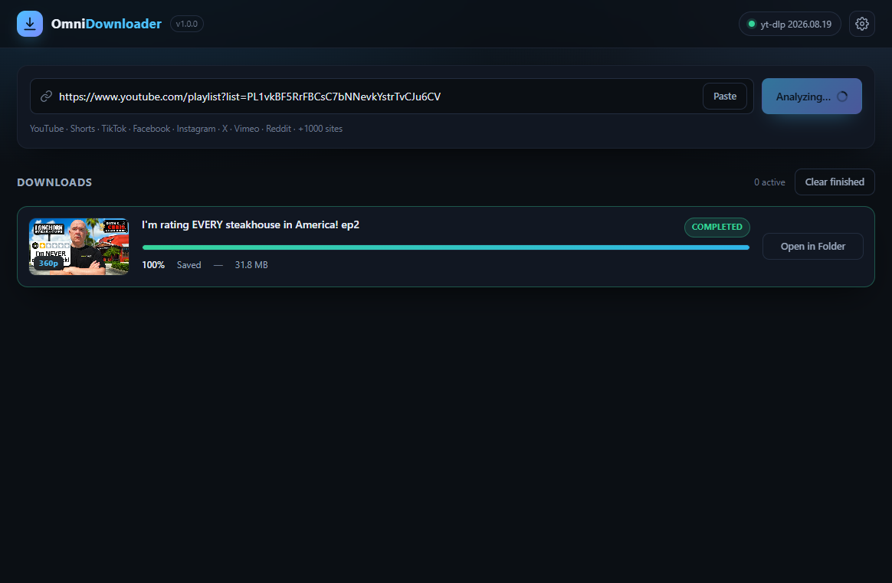
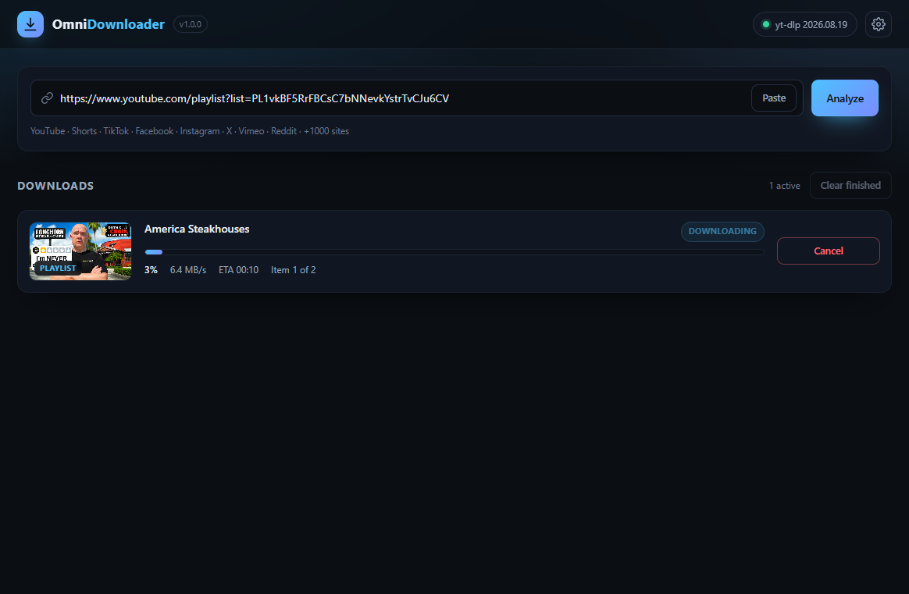
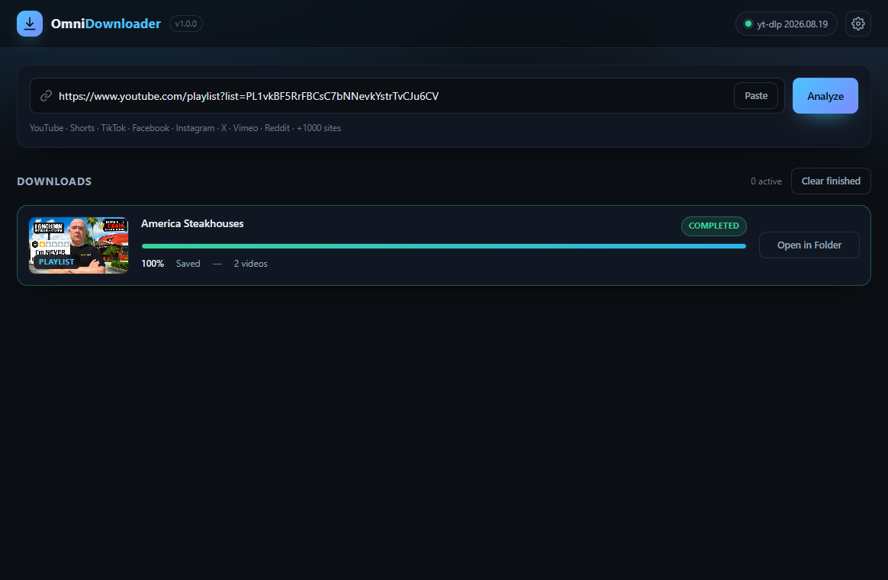

# OmniDownloader

[](LICENSE)
[](https://www.electronjs.org/)
[](https://github.com/yt-dlp/yt-dlp)
[](https://developer.mozilla.org/docs/Web/JavaScript)
[](#building-the-installer)

A production-ready desktop video & audio downloader built with **Electron + pure vanilla
HTML/CSS/JS** — no React, no Vue, no Angular, no Vite/Webpack/Tailwind, no bundler and no
build step. All extraction and downloading is done by a local **`yt-dlp`** child process,
with **`FFmpeg`** used for lossless stream merging and MP3 extraction.

```
npm install
npm start
```

<p align="center">
  
</p>

---

## Features

| Area | What you get |
| --- | --- |
| **Analyze** | Paste a link (Ctrl+V or the *Paste* button) → *Analyze* → title, uploader, duration, thumbnail and every available quality with **estimated file sizes** |
| **Quality picker** | 4K / 1440p / 1080p / 720p / 480p / 360p / … plus an **Audio (MP3)** option; the best matching resolution is preselected. Direct file links (MP4/WebM/…) that report no resolution are offered as a single *Video* option instead of hiding the choice |
| **Player-safe output** | The streams decide the container *before* anything downloads: **H.264 + AAC → `.mp4`** (the pair every player on every OS decodes), VP9/AV1 + Opus → `.webm`, mixed pairs → `.mkv` — and the fallback selector is codec-aware, so a file can never carry an extension its codecs don't fit |
| **Live task cards** | Thumbnail, animated progress bar, percent, `MB/s`, ETA and a status badge: `Queued → Downloading → Merging → Completed` |
| **Playlists** | Paste a playlist link and the quality modal lists **every video** it will fetch (plus whole-list size estimates). One task then downloads the **entire list**: ordered names (`001 - Title [id].mp4`), a `PLAYLIST` badge, an `Item 3 of 34` position and a **single progress bar for the whole run** that never moves backwards. Cancelling keeps the videos that already finished; a video that fails is skipped and reported instead of aborting the rest |
| **Queue** | Configurable concurrency (1–6 parallel jobs, default 2); extra tasks wait in a FIFO queue |
| **Cancel** | Kills the whole `yt-dlp`/`FFmpeg` process tree and purges `.part` / `.ytdl` / fragment files |
| **Reveal** | *Open in Folder* highlights the finished file in Explorer / Finder / Files (`shell.showItemInFolder`) |
| **Engine self-update** | `yt-dlp` is installed and updated automatically from the official GitHub Releases API |
| **Dark premium UI** | CSS-variable driven theme, keyboard accessible, responsive down to ~900 px |

Supported sites = everything [yt-dlp supports](https://github.com/yt-dlp/yt-dlp/blob/master/supportedsites.md)
(YouTube, Shorts, TikTok, Facebook, Instagram, X, Vimeo, Reddit, Twitch, … +1000 sites).

---

## Screenshots

<p align="center">
  
  
</p>
<p align="center">
  
  
</p>
<p align="center">
  
  
</p>
<p align="center">
  
</p>

---

## Requirements

* **Node.js 18+** (20/22/24 recommended) and npm
* **FFmpeg** — required for HD/4K merging (separate video + audio streams) and for MP3
  extraction. Without it the app still works and automatically falls back to the best
  single-file stream, showing a warning on the affected card.
* An internet connection (analysis, downloading, engine bootstrap/update)

`yt-dlp` itself needs **no manual install** — on first start the app fetches the correct
build from `https://api.github.com/repos/yt-dlp/yt-dlp/releases/latest` into
`app.getPath('userData')/binaries/`.

### Installing FFmpeg

| OS | Command |
| --- | --- |
| Windows | `winget install Gyan.FFmpeg` (then reopen the terminal) |
| macOS | `brew install ffmpeg` |
| Debian/Ubuntu | `sudo apt install ffmpeg` |
| Fedora | `sudo dnf install ffmpeg` |

Alternatively drop a static build into `assets/binaries/<os>/`
(`win32` / `darwin` / `linux`) — see `assets/binaries/README.md`.

---

## Usage

1. `npm start`
2. Paste a link into the URL bar → **Analyze** (Enter works too). Playlist, channel and
   `/playlist?list=` links are recognized as such — the quality modal then lists the videos
   and shows one size estimate *per video* for the whole list.
3. Pick a quality — each row shows an estimated size derived from `yt-dlp --dump-json`
   (bitrate × duration fallback when the site reports no exact size).
4. Press **Start download**. Watch the card: percent, speed, ETA, then `Merging streams…`
   and finally `Completed`. A playlist keeps one card for the whole run and reports its
   position (`Item 3 of 34`) while the bar climbs across all videos.
5. **Open in Folder** reveals the file; **Clear finished** empties the list.
6. ⚙️ settings: download folder (native folder picker), parallel downloads, engine
   versions and **Update engine**.

Files are saved as `<folder>/<Title> [id].mp4` (single video) or
`<folder>/001 - Title [id].mp4` (playlists) after sanitising the title for the filesystem.

---

## Project layout

```
package.json                 electron . → src/main/main.js (no build step)
src/
  main/
    main.js                  window lifecycle, settings store, service wiring
    logger.js                rotating file log (<userData>/logs/main.log, 1 MB)
    binaryManager.js         yt-dlp/FFmpeg resolution + GitHub self-update
    downloadManager.js       spawn → parse progress → status machine → queue/cancel
    ipcHandlers.js           the ONLY surface the renderer can reach (whitelisted)
  preload/
    preload.js               contextBridge: window.api (typed, validated channels)
  renderer/
    index.html / style.css / renderer.js      vanilla UI (CSP-restricted)
scripts/
  smoke.js                   end-to-end engine + download test suite
  ui-test.js                 end-to-end renderer test + screenshots (scripts/shots/)
  screenshots.js             regenerates the README gallery (npm run shots)
  make-icon.js               pure-Node icon generator
assets/binaries/<os>/        optional bundled yt-dlp / FFmpeg
docs/
  screenshots/               README gallery (npm run shots)
  OmniDownloader-SRS.md      software requirements specification
```

**Security model:** `contextIsolation: true`, `nodeIntegration: false`, `sandbox: true`,
a strict `Content-Security-Policy`, no remote content, no shell string concatenation
(`spawn` with argv arrays only), every IPC channel whitelisted and payload type-checked,
and file paths handed to the OS through `shell.showItemInFolder` — never `exec`.

**Progress parsing** follows the SRS-style regex contract
`xx% of ~MiB at x.xMiB/s ETA 00:12`, plus yt-dlp’s final per-stream summary line for very
fast downloads. `--progress --no-quiet --progress-delta 0.5` keeps the event stream
throttled and predictable.

---

## Scripts

| Command | What it does |
| --- | --- |
| `npm start` | Launch the app |
| `npm run smoke` | Headless end-to-end suite: engine bootstrap, analysis, a real download to completion, live progress events, cancellation + partial-file cleanup, invalid URL, MP3 extraction, and a **full playlist run** (analysis → every video saved → `Item n/N` counters → progress bar that never steps back). Every finished file is then **ffprobed for playability**: an audio stream must exist and any `.mp4` must be H.264 + AAC |
| `npm run uitest` | Drives the real renderer in a real `BrowserWindow`: analyze → quality modal → download → completed card → cancel → settings → clear finished → **playlist** (preview list, `PLAYLIST` badge, `Item x of y`, one bar for the whole list). Finished files are ffprobed for an audio stream / player-safe codecs, it fails on any renderer console error and writes screenshots to `scripts/shots/` |
| `npm run shots` | Regenerates the [screenshots](#screenshots) above: boots the real app over CDP, walks single-video + playlist flows with downloads redirected to a temp folder, and writes `docs/screenshots/*.png` |
| `npm run icon` | Regenerates `build/icon.png` + `build/icon.ico` (pure Node, no image dependencies) |
| `npm run dist` | Builds the Windows NSIS installer into `dist/` |
| `npm run dist:dir` | Builds an unpacked, portable app directory into `dist/win-unpacked/` (fast local check) |

Both suites hit the public network (YouTube / sample CDNs), so they need a connection.
If FFmpeg is missing, the MP3 assertions are reported as skipped/failed rather than
crashing the run.

---

## Building the installer

```bash
npm install
npm run dist
```

Produces `dist/OmniDownloader-Setup-1.0.0.exe` — a one-click per-user NSIS installer
that creates Start-menu and desktop shortcuts and installs to
`%LocalAppData%\Programs\OmniDownloader`. Uninstalling works from *Settings → Apps*.

* The packaged app is **asar-archived** and ships only `package.json`, `src/**` and
  `assets/**` — test scripts, screenshots and `node_modules` stay out.
* **FFmpeg is not bundled** (licensing + size); it is still discovered on `PATH` or via
  the *Locate* button in Settings. `yt-dlp` needs no bundling either: on first run the
  app downloads the current release from GitHub into its own `userData/binaries/`.
* Silent install / silent uninstall for deployment:
  `OmniDownloader-Setup-1.0.0.exe /S` and `%LocalAppData%\Programs\OmniDownloader\unins000.exe /S`.
* macOS/Linux targets can be added to the `build` section of `package.json`
  (`dmg`, `AppImage`, `deb`) — the app itself is already cross-platform.

---

## Troubleshooting

| Symptom | Fix |
| --- | --- |
| *“FFmpeg was not found…”* | Install FFmpeg (table above) or put the binary in `assets/binaries/<os>/`, then restart |
| MP3 or 4K option missing | Same as above — those qualities need FFmpeg, so the list hides them instead of failing later |
| *“This link could not be analyzed”* | Update the engine from ⚙️ → **Update engine**; sites change often and yt-dlp ships fixes continuously |
| Download stuck on *Queued* | Another job is running — lower/raise the parallel limit in settings |
| Corporate proxy / certificate errors | yt-dlp honours `HTTPS_PROXY`; Electron follows the OS proxy settings |
| Engine update fails | GitHub rate limit (60 req/h/IP, the app caches for 1 h) or offline — retry later |
| App opens then closes immediately | Nothing fails silently: a dialog is shown and the reason is written to `%APPDATA%\OmniDownloader\logs\main.log` (`logs/main.log` under `~/.config/OmniDownloader` on Linux, `~/Library/Application Support/OmniDownloader` on macOS). The log rotates at 1 MB |
| A playlist says *“N videos … could not be downloaded”* | Individual entries failed (removed video, region lock, rate limit) — the rest still landed in the folder. Re-run the link to retry only what is missing |
| A video plays but has **no sound** | A file from an *older build* paired VP9 + Opus inside `.mp4`, which Windows' built-in players can't decode (the picture shows, the sound doesn't). Re-download it with this build — it quotes **H.264 + AAC into `.mp4`** — or play the old file in VLC/mpv |

The engines are resolved in this order: `<userData>/binaries` → `assets/binaries/<os>` →
`$PATH`. Diagnostics (`yt-dlp --version`, `ffmpeg -version`) are shown live in the
settings modal.

---

## License

MIT — see [LICENSE](LICENSE).
